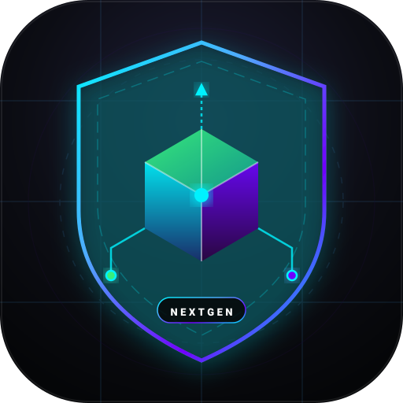

<div align="center">
  
  <h1>MCP NextGen Suite</h1>
  <p><strong>Suite open-source di Server e Strumenti per Model Context Protocol (MCP) ad alte prestazioni, con sicurezza integrata, token budgeting e diagnostica realtime.</strong></p>

  <p>
    <a href="https://github.com/francaroscillidev-gif/mcp-nextgen-suite/blob/main/LICENSE"></a>
    <a href="https://modelcontextprotocol.io/"></a>
    <a href="https://nodejs.org/"></a>
    <a href="https://github.com/francaroscillidev-gif"></a>
  </p>
</div>

---

## 💡 Perché questa Suite?

La maggior parte dei server MCP odierni ha tre problemi critici:
1. **Saturazione del contesto (Token Exhaustion):** Inondano il prompt con migliaia di righe di log o dump grezzi di tabelle.
2. **Fuga di credenziali e PII:** Restituiscono password, stringhe di connessione e token JWT non censurati.
3. **Mancanza di insight azionabili:** Spesso delegano all'LLM l'onere di comprendere comandi a basso livello anziché fornire tool orientati alla diagnostica.

**MCP NextGen Suite** introduce:
- **`@mcp-nextgen/core`**: Runtime MCP con sanitizer automatico di secret, pruner adattivo per preservare la context window, **Log Clustering algoritmico**, **Response Cache deterministica (TTL / LRU)**, **Sliding-Window Rate Limiter** e **Prometheus/OpenTelemetry Live Metrics**.
- **`@mcp-nextgen/cli` (`create-mcp-server`)**: CLI di scaffolding per generare in pochi secondi nuovi server MCP completi di guardrail di sicurezza e token budget.
- **`@mcp-nextgen/server-db-profiler`**: Profilazione in tempo reale di query lente, piani di esecuzione (EXPLAIN), analisi statica preventiva anti-pattern SQL (`sql_estimate_cost_impact`), suggerimento mirato di indici su SQLite e PostgreSQL, profilazione Redis e validatore di sicurezza migrazioni DDL.
- **`@mcp-nextgen/server-devops-k8s`**: Diagnostica zero-root, smart triage di pod in `CrashLoopBackOff`/`OOMKilled`, auditing `docker-compose.yml`, ispezione layer bloat Docker, tailing compatto dei log e security audit per carichi di lavoro K8s.

---

## 📦 Struttura del Monorepo

```text
tool mpc/
├── packages/
│   ├── core/                   # SDK con Sanitizer regex, Token Pruner e Log Clusterer
│   ├── generator-cli/          # CLI scaffolder ("create-mcp-server")
│   ├── server-db-profiler/     # Server MCP per SQLite & PostgreSQL
│   └── server-devops-k8s/      # Server MCP per Docker & Kubernetes
├── scripts/                    # Test di integrazione e demo
└── package.json
```

---

## 🚀 Generare un Nuovo Server MCP con la CLI

Puoi creare un nuovo server MCP istantaneamente con:

```bash
npx @mcp-nextgen/cli my-custom-server
# oppure direttamente da locale:
node packages/generator-cli/dist/index.js my-custom-server
```

---

## 🛠️ Come Eseguire e Integrare i Server

### 1. Build del Progetto
```bash
npm install
npm run build
```

```bash
# Esecuzione standard con stdio (per Claude Desktop, Cursor, Antigravity)
node packages/server-db-profiler/dist/index.js

# Esecuzione via rete / SSE (Server-Sent Events) per Agent Gateway remoti
node packages/server-db-profiler/dist/index.js --sse
# Porta di default: 3000 (configurabile con MCP_PORT=3000)
# Endpoint SSE: http://localhost:3000/sse
# Healthcheck K8s: http://localhost:3000/healthz
```

### Docker Container Deployment
```bash
# Build dell'immagine ottimizzata multi-stage
docker build -t mcp-nextgen-suite .

# Avvio container con esposizione SSE
docker run -p 3000:3000 -e MCP_PORT=3000 mcp-nextgen-suite --sse
```

### 2. Kubernetes Enterprise Deployment

Il repository include i manifest pronti all'uso in [`deploy/k8s/`](deploy/k8s/mcp-suite-deployment.yaml) con:
- Pod deployment a privilegi minimi (`readOnlyRootFilesystem: true`, non-root UID 1000).
- Probes native K8s di liveness e readiness su `/healthz`.
- ServiceAccount e ClusterRole a sola lettura (`pods`, `pods/log`, `events`, `deployments`) senza permessi di modifica o cancellazione.

```bash
kubectl apply -f deploy/k8s/mcp-suite-deployment.yaml
```

### 3. Configurazione nei Client MCP (Claude Desktop, Cursor, Antigravity)

Aggiungi i server al tuo `mcpServers` nel file di configurazione del tuo client:

```json
{
  "mcpServers": {
    "db-profiler": {
      "command": "node",
      "args": ["/path/to/tool mpc/packages/server-db-profiler/dist/index.js"]
    },
    "devops-k8s": {
      "command": "node",
      "args": ["/path/to/tool mpc/packages/server-devops-k8s/dist/index.js"]
    }
  }
}
```

---

## 🔍 Tool Disponibili

### DB Profiler (`@mcp-nextgen/server-db-profiler`)
- `sqlite_inspect_schema`: Schema rapido, conteggio righe, indici e vincoli FK.
- `sqlite_profile_query`: Esegue `EXPLAIN QUERY PLAN`, individua `SCAN TABLE` / `TEMP B-TREE` e raccomanda indici specifici.
- `postgres_explain_analyze`: Esegue in transazione protetta a sola lettura con `ROLLBACK` forzato `EXPLAIN (ANALYZE, BUFFERS, FORMAT JSON)`.
- `postgres_inspect_slow_queries`: Analizza `pg_stat_statements` per isolare le query a maggior consumo di tempo.
- `sql_estimate_cost_impact`: Analisi statica preventiva pre-esecuzione (rileva join cartesiani impliciti, predicati `LIKE %term` non sargabili e funzioni su colonne indicizzate).
- `sql_validate_migration_safety`: Analizzatore statico per migrazioni DDL (rileva lock esclusivi di tabella, indici senza `CONCURRENTLY`, colonne `NOT NULL` senza default e `DROP` rischiosi).
- `redis_analyze_slowlog_and_memory`: Analisi di comandi bloccanti O(N) (`KEYS *`, `HGETALL`), frammentazione della memoria RSS e policy di eviction OOM su Redis.

### DevOps & K8s Copilot (`@mcp-nextgen/server-devops-k8s`)
- `docker_ps_health`: Elenco sintetico dello stato di salute e porte dei container.
- `docker_diagnose_container`: Analisi dello stato, exit code, flag `OOMKilled` e ultimi log con deduplicazione algoritmica.
- `docker_compose_audit`: Security & reliability linter per file `docker-compose.yml` (password in chiaro, porte DB esposte pubblicamente, `privileged: true`, loop di riavvio).
- `docker_image_inspect_layers`: Diagnostica bloat dei layer Docker, residui di cache dei package manager (`apt-get`, `npm`, `pip`) e raccomandazioni per multi-stage build.
- `k8s_cluster_health`: Triage cluster: filtra e mostra solo i pod in stato anomalo/degradato.
- `k8s_diagnose_pod`: Recupero mirato di eventi recenti e log clusterizzati del pod.
- `k8s_security_audit_manifest`: Security linter per manifest YAML o pod live (rileva root execution UID 0, privilegi elevati, namespace host condivisi e limiti CPU/RAM mancanti).

---

## 🤖 CI / CD Automatizzata

Il repository include una GitHub Actions pipeline ([`.github/workflows/ci.yml`](.github/workflows/ci.yml)) che verifica automaticamente:
- Matrice di compilazione TypeScript su Node.js 18.x, 20.x, 22.x
- Esecuzione dei test di integrazione per tutti i server MCP.

---

## 📑 Prompts e Resources Native MCP

I server implementano le specifiche complete MCP oltre ai soli Tool:
- **MCP Prompts:**
  - `diagnose-query-slowness`: Prompt ingegnerizzato per guidare gli LLM come esperti DBA con checklist di tuning.
  - `pod-crash-triage`: Prompt strutturato per RCA (Root Cause Analysis) di incidenti Kubernetes.
- **MCP Dynamic Resources:**
  - `telemetry://system/live-metrics`: Risorsa dinamica con memoria, uptime e telemetria dei backend in tempo reale.

---

## 📬 Contact, Support & Commercial Inquiries

If you have questions, feedback, enterprise integration requests, or custom agent governance needs, feel free to reach out directly:

- **Lead Developer & Maintainer**: Franca Roscilli
- **Email**: [francaroscillidev@gmail.com](mailto:francaroscillidev@gmail.com)
- **GitHub**: [@francaroscillidev-gif](https://github.com/francaroscillidev-gif)
- **Bug Reports & Feature Requests**: [Open an issue on GitHub](https://github.com/francaroscillidev-gif/mcp-nextgen-suite/issues)

---

## 👩‍💻 Author & Credits

- **Author**: Franca Roscilli
- **Email**: [francaroscillidev@gmail.com](mailto:francaroscillidev@gmail.com)
- **GitHub**: [@francaroscillidev-gif](https://github.com/francaroscillidev-gif)
- **License**: Apache 2.0 (vedi [LICENSE](LICENSE))

